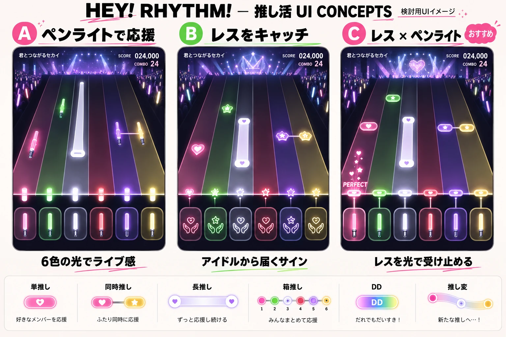
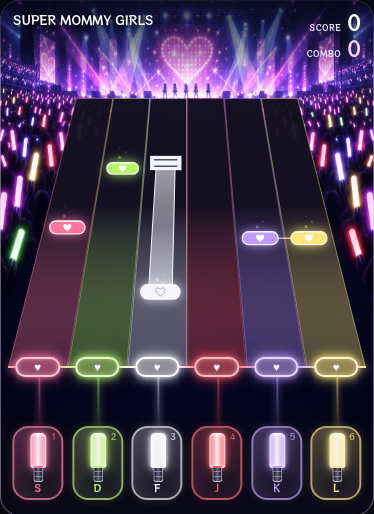

# レス × ペンライト：C案の実装

比較基準は、次の検討画像の右端のC案です。

## 実際のゲーム描画

実装した共通レンダラーを、390×844のChromiumタッチ画面で撮影しています。テスト用の単推し・同時推し・長推し・DDを描き、動画はテスト用APIです。画像はボタン下の余白を除くプレイ枠を撮影したもので、実際の画面では上にYouTubeプレーヤーと再生操作があります。

## 画像に合わせた部分

- 6人のアイドルシルエット・ハートのLED・交差する照明・両側の客席とペンライトがある会場。C案を参照して生成した背景をWebPで配信し、レーン床とボタン側の陰影まで含めて1枚にキャッシュします。Canvasの内部解像度は画面密度2倍を上限とし、サイズ・密度の変更と画像の読み込み完了時にキャッシュを更新します。
- 奥が狭く手前が広い6レーン、暗い路面から6色へ変わるグラデーション、細い境界線。
- ネオンの白い輪郭とハートを持つノーツ、光のリボンになる長推し、実際のノーツを直線でつなぐ同時推し。
- 6個の受け口をつなぐ水平の光、受け口とペンライトの間を結ぶ光、大きい発光部と細いグリップのあるボタン。
- プレイ枠の左上に曲名、右上にスコアとコンボ。下端のブラウザ用余白は枠の外へ確保。

## ゲームとしての仕様

横方向の遠近感だけを変え、全レーンの縦方向の速度・到達時刻・水平の判定位置は共通です。最近の親指向けボタン位置と44〜92px＋セーフエリアの余白を保ち、判定時間・得点・MIDI割り当ても共通です。白ノーツのハートは白に薄紫の縁取り、長推しの終端は二重線、箱推しは金色のスワイプレール、DDは厚さ10px基準の虹色の1タップバーで読み分けます。通常タップの判定は±50/100/160ms、長推し・推し変の終点と推し変の移動ポイントは±100/180/250ms（PERFECT/GREAT/GOOD）です。

YouTubeは操作できるプレーヤーとして表示し、PCではプレイ枠の右、スマホ縦画面では上に置きます。ゲーム用の画像でMVを置き換えず、曲の映像・音声は公式プレーヤーから再生します。
