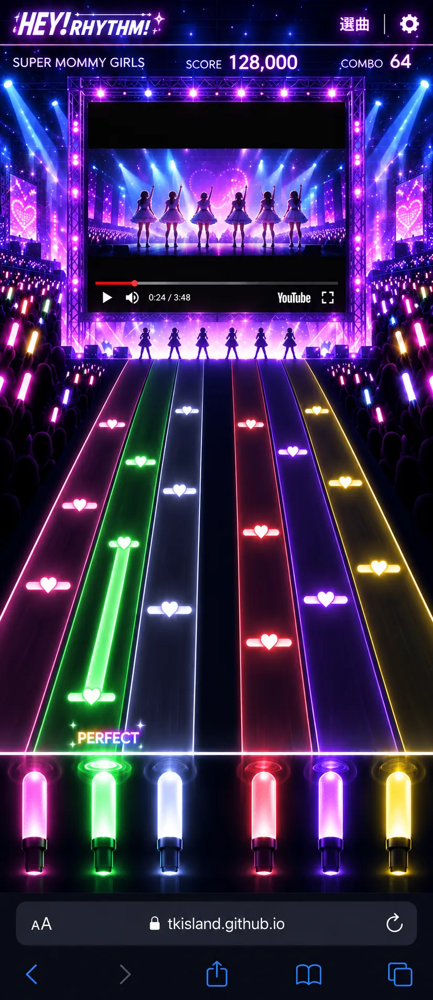
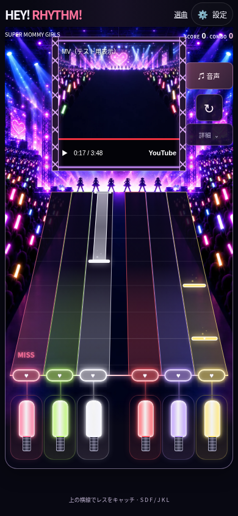

# ステージ映像モニターと会場の連続表示

動画の横の照明からステージ、ノーツの横の客席までを、一枚の背景Canvasで表示します。前の実装は、動画側のCSS背景とノーツ側のCanvas背景で画像の縮尺が異なり、境目に別のステージが現れていました。

## 基準のイメージ

## 実装した画面

Chromiumの390×844タッチ画面で実際のアプリを撮影しています。動画部分はネットワークを使わないテスト用の静止画・操作表示です。製品にはこの静止画や模擬操作UIを入れず、YouTube公式プレーヤーをそのまま表示します。実機のMV再生は未検証です。

- 天井のトラス、左右の照明、6人のシルエット、両側のペンライトの客席を共通の会場にまとめています。背景のステージ床をレーン始点に合わせ、ノーツCanvasの上部・左右を透過させます。
- モニターの装飾はiframeの外側です。プレーヤーはスマホで200×200px、PCで240×200pxを保ち、画面内のYouTubeの操作を覆いません。
- モニター横の再生操作・設定と、幅の等しい6レーン、白と赤の間隔、ボタン下のブラウザ用余白を保ちます。ペンライトの発光部を大きくし、スマホではキーボード用の文字を省きます。
- 画面の短い縦向きではスコアを横に置き、短い横向きではモニターとゲームを左右に分けます。ノーツの移動時間・判定・譜面は変更しません。
- 追加した会場画像は約116KBのWebPです。背景Canvasは画像読み込み時と配置変更時に更新し、再生やタップのたびには描き直しません。
