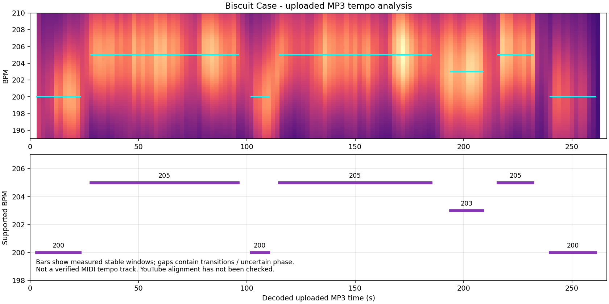

# ビスケットケース：BPM測定

提供された `【4K Performance】ビスケットケース Hey!Mommy!.mp3` を解析しました。開始は約200 BPM、主部は約205 BPMです。途中に約200 BPM・203 BPMへ変わる区間があり、全曲を205 BPM固定で打ち込むとずれます。半分のテンポで数える場合は、それぞれ100・102.5・101.5 BPMに相当します。

動画IDはユーザー指定の `JUsGoi24rug`。以下の秒数は**デコードしたアップロードMP3の先頭を0秒**にした値です。YouTubeとの頭合わせ・小節頭は未確認です。元音源はリポジトリに含めません。

| 区間の目安（MP3） | 推定BPM | 安定区間を用いた自由推定の例 |
| --- | ---: | --- |
| 冒頭〜約0:25 | 200 | 5〜18秒：200.19 |
| 約0:25〜1:41 | 205 | 27〜98秒：205.003 |
| 約1:41〜1:53 | 200 | 100〜112秒：200.05 |
| 約1:53〜3:08 | 205 | 115〜185秒：204.997 |
| 約3:08〜3:34 | 203 | 194〜209秒：203.017 |
| 約3:34〜3:56 | 205 | 216〜228秒：205.24／224〜236秒：204.85 |
| 約3:56〜4:00 | 移行区間 | 変更位置・減速の形は要確認 |
| 約4:00〜終盤 | 200 | 240〜261秒：199.979 |

切り替え時刻は数秒程度の幅を持つ暫定値です。短い窓の推定は前後のテンポや歌・細かい打楽器の影響を受けます。上の小数は推定結果の記録であり、その精度でテンポが確定した意味ではありません。特に終盤の移行部分を確定したステップ変更と見なさないでください。

最初の明瞭な強い立ち上がりは約2.995秒でした。この測定値を使っていた初期の推定テンポ設定は、現在は提供された`game-BSC002.mid`のテンポイベントとユーザー指定の開始位置に置き換えています。**動画2.95秒がMIDIの0秒**です。最初のノーツはMIDIの3拍後、動画3.85秒です。

MIDI由来の変更位置は動画24.549375／100.647304754／112.647304754／188.744624754／213.572168754／235.83734215秒です。ゲームと新規譜面のグリッドはこの値を使用し、上の音源解析の概算区間は使用しません。既存の下書きには自動適用しません。詳細は[収録譜面BSC002](../../../README.md#収録譜面-bsc002ビスケットケース)を参照してください。

## 測定方法とデータ

- ffmpeg 7.1.5でMP3を22,050 Hz・モノラルfloat PCMへデコード。デコード後の長さは266.170340秒。コンテナの266.213878秒との差はMP3の遅延・パディング等を含むため、コンテナ長から拍位置を計算していません。
- SciPy 1.17.0／NumPy 2.3.5でSTFT（2048サンプル、hop 128）を計算。周波数帯30〜180 Hz／180〜2000 Hz／2000〜10000 Hzの正のスペクトル差分から立ち上がり強度を抽出し、帯域ごとに正規化しました。
- 8秒窓・2秒刻みで70〜230 BPMの自己相関を比較。100〜102.5 BPMの半テンポ候補も確認しています。
- 12秒窓・4秒刻みで196〜208 BPMと拍位相を同時に最適化し、長い安定区間でも再推定しました。主部の低・中・高域は、例えば27〜98秒でそれぞれ204.992／205.002／205.015 BPMとなり、205 BPMを支持します。位相には裏拍・8分音符との曖昧さが残ります。
- 図の下段は、固定BPMの位相探索も行った安定区間だけを示します。切り替え位置の確定図ではありません。

[analysis.json](analysis.json) に音源のSHA-256・時刻基準・未検証事項・概算区間を、[local-fits.csv](local-fits.csv) に12秒窓の推定結果（秒数・BPM・位相・スコア）を保存しています。JSONの区間開始は目安であり、そのままMIDIへ変換するための完成したテンポトラックではありません。

現在は提供MIDIを変換したBSC002を選曲画面からプレイできます。音源そのものはリポジトリに含めません。
